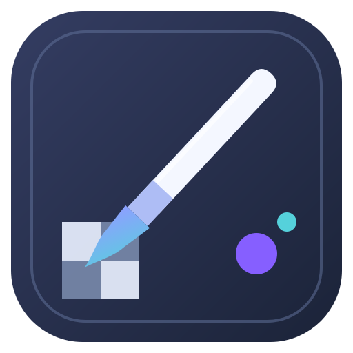
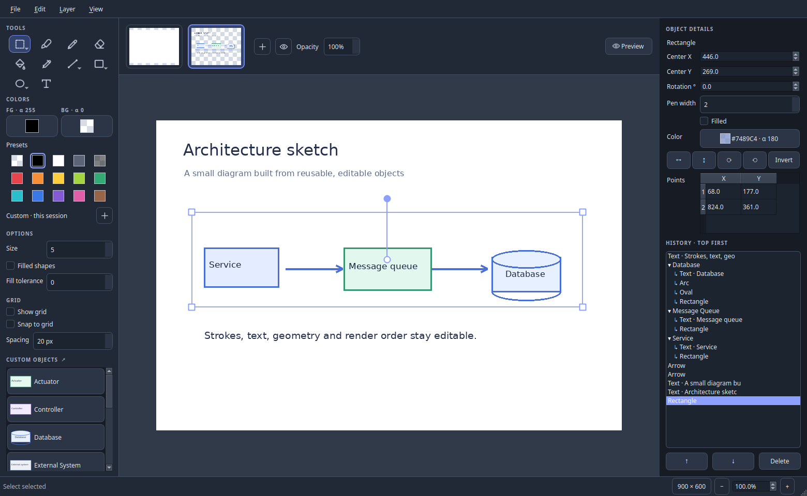

<p align="center"></p>

# Painter

Painter is a desktop paint app for Linux and Windows with RGBA colors, editable
shapes, layers, and reusable custom objects. It keeps the direct feel of a basic
paint program while allowing transparent and semi-transparent drawing.



## Download and run

Download the single-file executable for your system from this repository's
**Releases** page. Python is not needed to run it.

| System | Release file | Run |
| --- | --- | --- |
| Linux x86_64 | `Painter-linux-x86_64` | `chmod +x Painter-linux-x86_64 && ./Painter-linux-x86_64` |
| Windows x86_64 | `Painter-windows-x86_64.exe` | Double-click the file |

The Linux release is built on Ubuntu 22.04 for broad glibc compatibility. It
may need your distribution's standard Qt/XCB desktop libraries. The Windows
release is built on Windows, because PyInstaller builds for the OS it runs on.
Neither version needs an installer. The one-file app extracts to a temporary
folder while running; projects and exports go wherever you save them.

### Run from source

Requires Python 3.10 or newer.

```bash
python -m pip install -e .
python -m painter
```

`python main.py` and the installed `painter` command work too.

## Drawing

- **Tools:** select, brush, pencil, eraser, fill, color picker, line, rectangle,
  oval, and text. Hover over an icon for its name and shortcut. The small arrows
  on Select, Line, Rectangle, and Oval open related tools such as freeform
  selection, spline, polygon, and arc.
- **Colors:** foreground and background/fill selectors are side by side. The
  color picker has a circular wheel, shade and alpha sliders, and RGBA, HSV,
  and HSL fields. Presets include fully transparent color. Save custom colors
  for the session; double-click a custom swatch to change every object linked
  to it. Filled shapes use the background color inside and the foreground color
  for their borders.
- **Gradients:** choose linear from an edge or radial from a point. Set the
  start and stop colors and the position of their halfway color. A radial
  gradient reaches its stop color at every shape edge.
- **Shapes and text:** adjust handles after drawing, or enter exact points,
  center, size, and rotation in Object details. Text is edited on the canvas
  and wraps to its box width; extra lines extend below the box.
- **Selections:** rectangular, polygon, and freeform selections can move or
  resize selected pixels. Copy and paste keep pasted pixels editable in the
  active layer.
- **Grid:** show a grid, snap to it, and change its spacing. Changing spacing
  rescales editable objects while keeping canvas dimensions fixed. The grid is
  an editor overlay unless you opt to include it on export.

## Layers, history, and custom objects

Layer previews above the canvas run **bottom to top from left to right**. Each
new layer goes on top, and transparent pixels reveal lower layers. Drag previews
to reorder layers; use **Preview** to see the final composite. The History panel
lists strokes, erasures, shapes, text, and other editable operations. Select an
item to change its details or render order. Undo and redo preserve those edits.

Choose **View → Create custom object** to draw a reusable item in a separate
Painter editor. Save it through **Custom Object → Save to custom objects**.
Painter trims unused canvas space and keeps the editable object history.
The Custom Objects area at the bottom of the left rail shows frequently used
items first; double-click its heading to open the full browser. Click a tile,
then click the canvas to place it. Use a tile's **⋯** button or right-click it
to edit or delete the definition. Definition changes affect future placements;
items already placed on a canvas keep their own editable copies. Included
architecture and systems engineering objects work the same way.

Custom definitions are saved under `$XDG_DATA_HOME/painter/custom-objects`
on Linux (normally `~/.local/share/painter/custom-objects`) and
`%APPDATA%\Painter\custom-objects` on Windows. Existing definitions in the
older `alpha-painter` location are copied to the new location on first run.

## Files and shortcuts

Save editable work as a `.painter` project. This format is a ZIP archive of
layer images, object history, and a JSON manifest. Export a flattened image
with **File → Export image**; PNG is the default, and other formats supported
by Pillow are available. Exported PNGs retain transparency. Painter can open
PNG, JPEG, BMP, and WebP images for editing.

| Action | Shortcut |
| --- | --- |
| Save project | Ctrl+S |
| Export image | Ctrl+E |
| Undo / redo | Ctrl+Z / Ctrl+Shift+Z |
| Copy / paste | Ctrl+C / Ctrl+V |
| Zoom in / out | Ctrl++ / Ctrl+- |

Painter starts in dark mode; choose **View → Theme → Light** for light mode.

## Develop and release

```bash
python -m pip install -e . pytest
python -m pytest -q
python -m pip install -r requirements-build.txt
python scripts/build_portable.py
python scripts/smoke_portable.py dist/Painter-linux-x86_64
```

`build_portable.py` produces a one-file app for the **current** operating
system. The [GitHub Actions workflow](.github/workflows/portable.yml) builds
and tests both Linux and Windows. A `vX.Y.Z` tag matching the project version
publishes both executables and SHA-256 checksums in a GitHub release. See
[release instructions](docs/RELEASING.md) and [contribution notes](CONTRIBUTING.md).

Licensed under [MIT](LICENSE).
